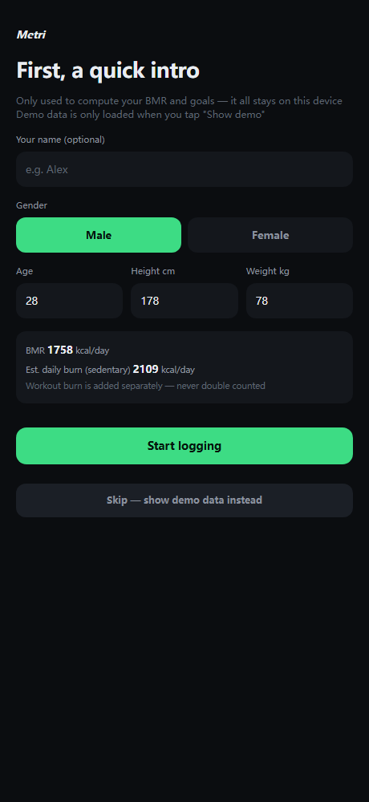
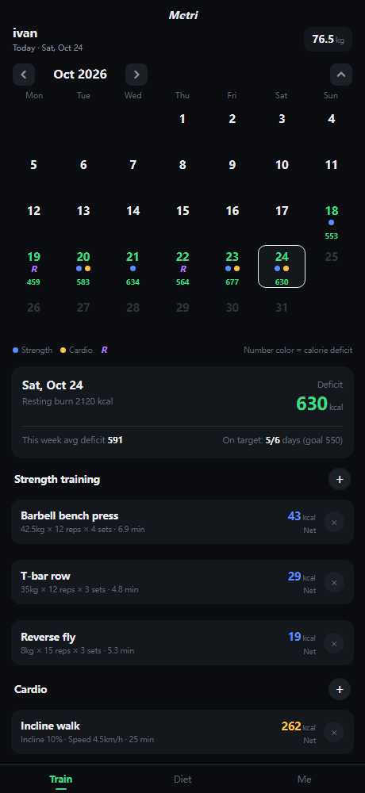
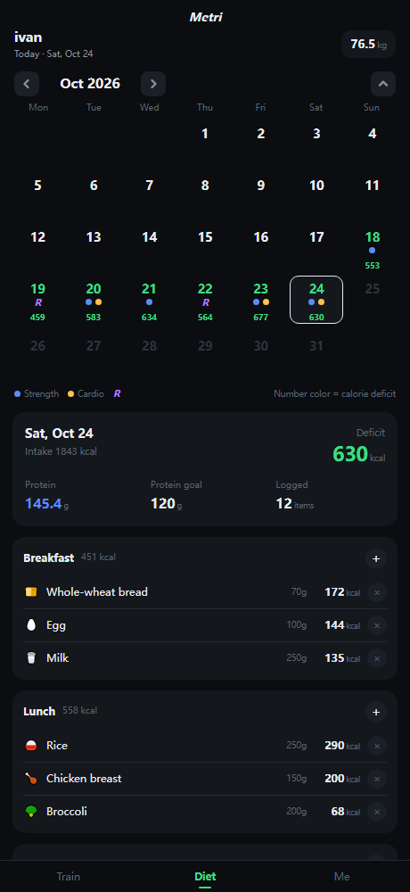
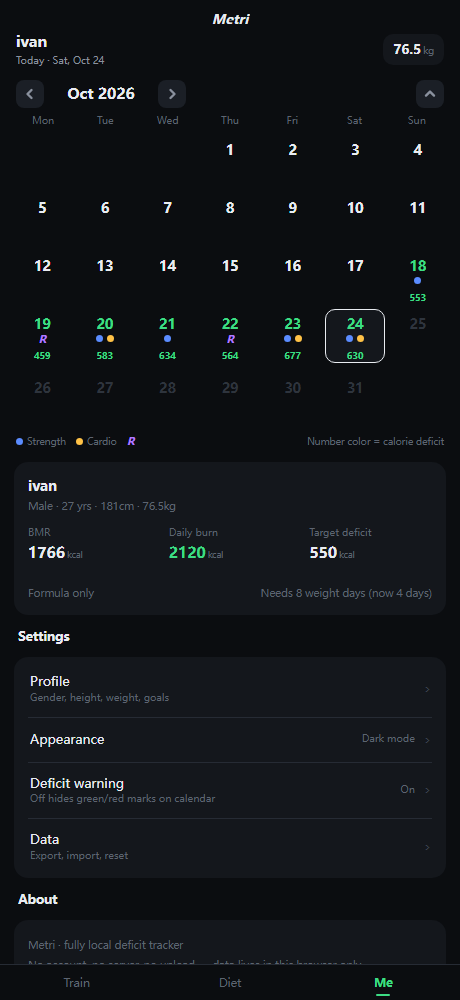

# Metri · Deficit Tracker

**Metri** is a no-frills fat-loss tracker: log your food, log your workouts, and keep an eye on the two numbers that actually matter — **calorie deficit** and **protein**. No account, no server, no upload — everything stays on your device.

**[⬇ Download Android APK (v1.1)](https://github.com/angryc0de/metri/releases/latest) · [🌐 Try the web version](https://metri.app.workbuddy.host/?sharecode=7OJK3AJQIJ) — or run `web/` on any static host**

<p align="center">
  
  
  
  
</p>
<p align="center"><sub>Web version, English mode (dark theme). Light theme available too.</sub></p>

The same product ships as two independent implementations:

| Target | Stack | Location | Best for |
|---|---|---|---|
| **Android** | Kotlin + Jetpack Compose + Room | `app/` | Daily long-term use, with AI meal breakdown via any OpenAI-compatible endpoint (e.g. the free Zhipu GLM-4-Flash) |
| **Web** | Plain HTML + CSS + vanilla JS — zero deps, zero build | `web/` | Instant use and easy sharing; runs in any modern browser |

## Features

1. **Log food** — built-in common foods by serving or gram; anything else, just describe it (e.g. "beach meal-prep box") and it gets broken down into an itemized list you can review (local rule-based estimation on Web, LLM-powered on Android).
2. **Log workouts** — strength machines and cardio both compute **net burn live via MET**: added weight raises intensity, incline/speed raise MET, and the resting burn during the session is subtracted so nothing is double-counted against BMR.
3. **Watch the deficit** — the calendar shows at a glance which days hit a deficit and which overshot; the weekly strip gives average deficit vs. target and days on target (deficit within ±100 kcal of goal counts).
4. **Your data, yours** — full JSON backup plus per-table CSV export; both apps share an identical data model (dates as epochDay) so backups are interchangeable.
5. **Bilingual** — both apps follow the system language (English/Chinese) automatically; the web version also accepts `?lang=en` / `?lang=zh` overrides. Every screen, exercise, food and hint is translated.

## Project layout

```
├── app/                Android app (Kotlin + Compose + Room)
│   └── src/...         LeanLogMath.kt (math) / Room (data) / Compose (UI)
├── web/                Web app (index.html + css/ + js/)
│   └── js/math.js      Math layer, 1:1 port of the Kotlin version
├── tools/
│   ├── check-web.js    Math-layer checks (aligned with Android JUnit expectations)
│   ├── check-i18n.js   Web translation-coverage check
│   ├── check-i18n-android.js  Android translation-coverage check
│   ├── e2e.js          Web end-to-end tests (Edge CDP, 34 assertions incl. EN mode)
│   ├── MakeIcon.java   Adaptive icon generator (glyph outline → vector + PNGs)
│   └── crop.py         Screenshot cropping helper
├── gradle/             Gradle wrapper
└── build.gradle.kts    Root build script
```

## Build & run

### Android

```bash
# JDK 17+; open the repo root in Android Studio, or:
./gradlew :app:assembleDebug
adb install -r app/build/outputs/apk/debug/app-debug.apk
```

### Web

Zero build — any static server works:

```bash
cd web
python -m http.server 8000
# open http://localhost:8000
# optional params: ?demo=1 sample data  ?theme=light light theme  ?view=diet jump to a tab  ?lang=en force English
```

### Tests

```bash
node tools/check-web.js              # math layer alignment
node tools/check-i18n.js             # web translation coverage
node tools/check-i18n-android.js     # Android translation coverage
node tools/e2e.js                    # web end-to-end (needs Edge)
```

## Privacy

- All data lives on-device (Android: Room; Web: localStorage) — nothing ever leaves your device
- Android's AI breakdown requires you to paste your own API key in Settings; requests go straight to the endpoint you configure, with no middleman
- The signing keystore (`keystore/`) is not distributed with this repo

## License

MIT

[简体中文说明](README.zh-CN.md)
